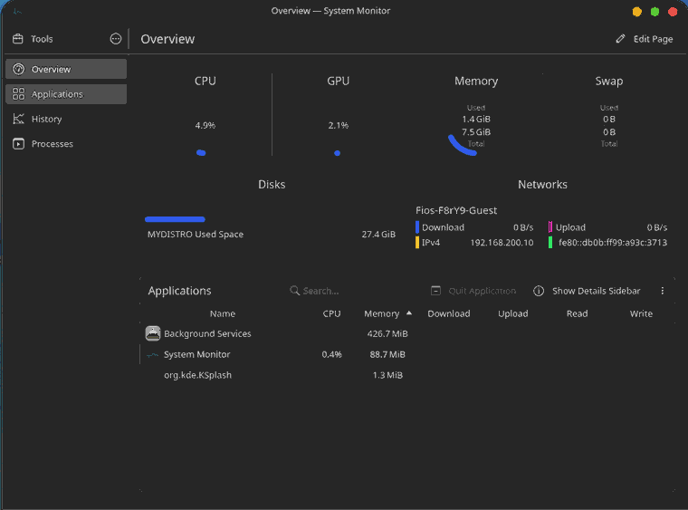

# NoahOS

**A custom Arch Linux-based distribution built around KDE Plasma.**

Visit the NoahOS website: https://somerandomtechperson.github.io/Noah-OS/index.html

NoahOS is a personal Linux distribution project focused on creating a clean, modern, and cohesive desktop experience. Built on Arch Linux and powered by KDE Plasma, NoahOS combines a customized desktop environment with a bootable live system.

> Currently under development. Features and documentation may change.

## Features

- **Arch Linux base** — Built using Arch Linux and Archiso.
- **KDE Plasma desktop** — A customized KDE Plasma experience.
- **Custom desktop design** — Original NoahOS branding, wallpaper, panels, and desktop layout.
- **Live environment** — Boot and use NoahOS without installing it.
- **UEFI and BIOS support** — Supports both modern UEFI and legacy BIOS boot modes.
- **Runs from memory** — The live environment can continue running after the boot media is removed, once fully loaded.

## Screenshots

### Desktop

### Applications

### System Information

## Performance Comparison

Both screenshots were captured while the same laptop was idle, with no user applications running. The system uses an **11th Gen Intel Core i5-1135G7** processor.

| Reading | Windows | NoahOS |
|---|---:|---:|
| CPU utilization | 23% | 4.9% |
| Memory in use | 6.2 / 7.7 GB (81%) | 1.4 / 7.5 GiB (~19%) |

### Windows

### NoahOS

In these snapshots, NoahOS showed approximately **79% lower CPU utilization** and substantially lower reported memory use.

*These are idle, point-in-time readings—not a controlled benchmark or a guarantee of performance on other hardware. The screenshots use different system monitors and memory units (GB vs. GiB), and readings can vary with uptime, background services, drivers, and system state. See the [full performance comparison](https://somerandomtechperson.github.io/Noah-OS/performance.html) for context.*

## Getting Started

Bootable ISO downloads and instructions will be provided through the project's [GitHub Releases](https://github.com/somerandomtechperson/Noah-OS/releases).

## Project Status

NoahOS has successfully booted and run on physical hardware, in addition to being tested in a virtual machine.

The project is currently in development. More testing, improvements, and documentation are planned.

## Built With

- [Arch Linux](https://archlinux.org/)
- [KDE Plasma](https://kde.org/plasma-desktop/)
- [Archiso](https://wiki.archlinux.org/title/Archiso)

## Contributing

Contributions, suggestions, and bug reports are welcome!

See [CONTRIBUTING.md](CONTRIBUTING.md) for guidelines.

## License

Original NoahOS project files are licensed under the [MIT License](LICENSE).

Third-party software and assets retain their respective licenses. See [THIRD-PARTY-NOTICES.md](THIRD-PARTY-NOTICES.md) for additional information.

---

**NoahOS — A Linux desktop built from the ground up.**
