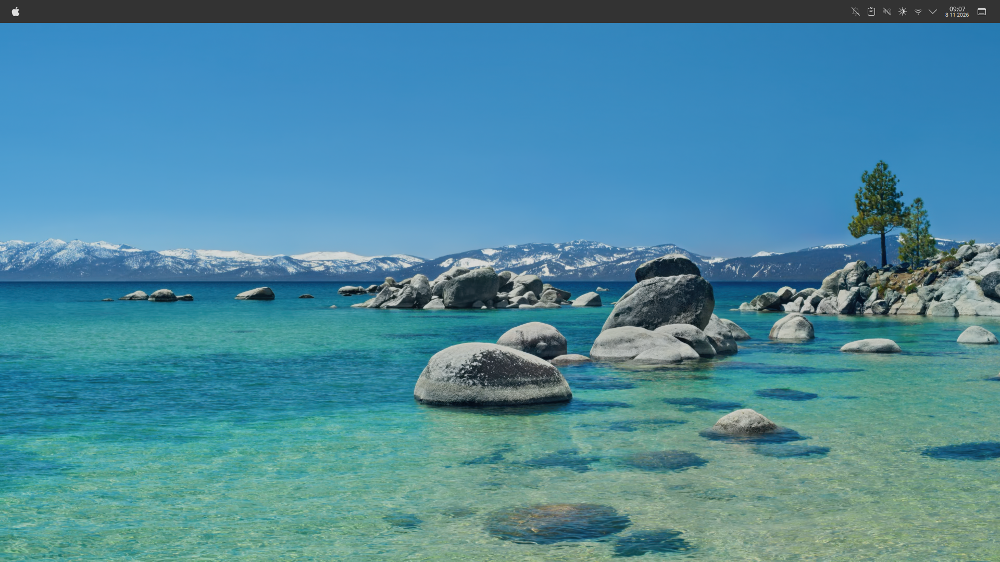
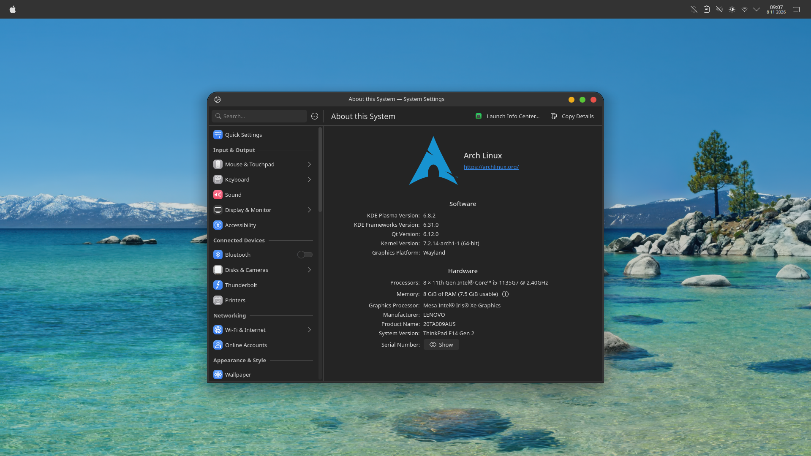
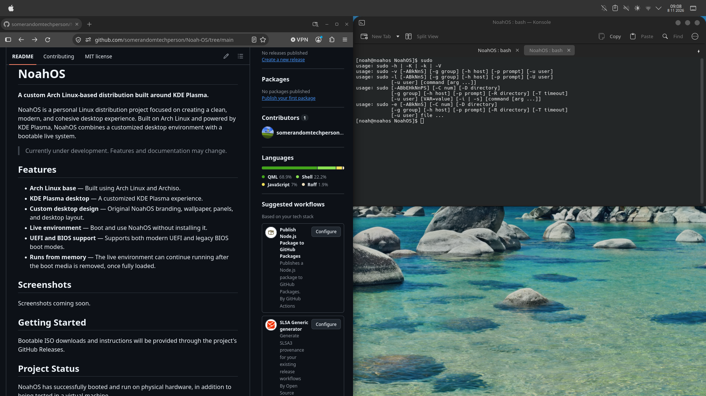

# NoahOS

**A custom Arch Linux-based distribution built around KDE Plasma.**

NoahOS is a personal Linux distribution project focused on creating a clean, modern, and cohesive desktop experience. Built on Arch Linux and powered by KDE Plasma, NoahOS combines a customized desktop environment with a bootable live system.

> Currently under development. Features and documentation may change.

## Features

- **Arch Linux base** — Built using Arch Linux and Archiso.
- **KDE Plasma desktop** — A customized KDE Plasma experience.
- **Custom desktop design** — Original NoahOS branding, wallpaper, panels, and desktop layout.
- **Live environment** — Boot and use NoahOS without installing it.
- **UEFI and BIOS support** — Supports both modern UEFI and legacy BIOS boot modes.
- **Runs from memory** — The live environment can continue running after the boot media is removed, once fully loaded.

## Screenshots

### Desktop

### Applications

### System Information

## Getting Started

Bootable ISO downloads and instructions will be provided through [GitHub Releases](https://github.com/somerandomtechperson/Noah-OS/releases).

## Project Status

NoahOS has successfully booted and run on physical hardware, in addition to being tested in a virtual machine.

The project is currently in development. More testing, improvements, and documentation are planned.

## Built With

- [Arch Linux](https://archlinux.org/)
- [KDE Plasma](https://kde.org/plasma-desktop/)
- [Archiso](https://wiki.archlinux.org/title/Archiso)

## Contributing

Contributions, suggestions, and bug reports are welcome!

See [CONTRIBUTING.md](CONTRIBUTING.md) for guidelines.

## License

Original NoahOS project files are licensed under the [MIT License](LICENSE).

Third-party software and assets retain their respective licenses. See [THIRD-PARTY-NOTICES.md](THIRD-PARTY-NOTICES.md) for additional information.

---

**NoahOS — A Linux desktop built from the ground up.**
